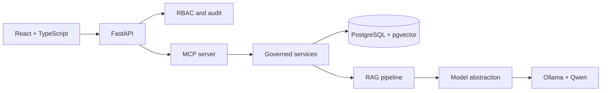

# Engineering Intelligence & Lessons Learned Platform

An enterprise-style portfolio project demonstrating governed data engineering, retrieval-augmented generation (RAG), AI agents, MCP tools, APIs, role-based access control, auditability, and CI/CD.

> **Data safety:** Every project, customer, person, issue, lesson, and engineering document in this repository is synthetic. No Siemens Energy or other confidential company data is used.

## Status

Repository foundation created. Phase 1 (database schema and synthetic data) is the first implementation phase and has not yet been marked complete.

## Planned architecture



Authorization will be applied before retrieval and before every MCP tool returns data. Document retrieval will default to the latest released revision.

## Repository layout

```text
backend/          FastAPI application and backend tests
frontend/         React + TypeScript + Vite application
database/         Versioned schema migrations and seed entry points
data/synthetic/   Generated, non-confidential fixtures
mcp_server/       Authorized MCP tool server
docs/             Architecture decisions, diagrams, and screenshots
scripts/          Developer and data-generation utilities
tests/contracts/  Cross-service and MCP contract tests
.github/workflows CI/CD workflows added with the relevant phase
```

## Incremental delivery plan

1. Database schema and synthetic data
2. FastAPI
3. Governance and data quality
4. RAG
5. MCP
6. Agent workflow
7. RBAC and audit logging
8. React UI
9. Test hardening
10. Docker and CI/CD

Each phase will be implemented and tested before the next begins. The README will grow with verified architecture, screenshots, demo scenarios, limitations, and cloud-migration guidance as those capabilities are delivered.

## Technology direction

- Frontend: React, TypeScript, Vite
- Backend: Python, FastAPI
- Data: PostgreSQL, pgvector
- Local AI: Ollama, Qwen, Sentence Transformers
- Integration: MCP Python SDK
- Delivery: Docker Compose, GitHub Actions, GitHub Pages

The LLM boundary will remain provider-neutral so Ollama can later be replaced by Azure OpenAI, OpenAI, or another enterprise provider without rewriting governance, retrieval, or MCP layers.

## Development

The active integration branch is `develop`. Feature work should use short-lived branches and merge into `develop`; stable releases merge into `main`.

Setup and run commands will be added in Phase 1 when executable components and pinned dependencies are introduced.

## License

Licensed under the MIT License. See [LICENSE](LICENSE).
