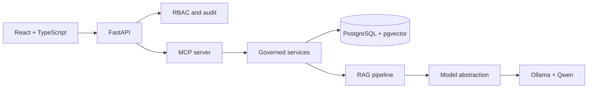

# Engineering Intelligence & Lessons Learned Platform

An enterprise-style portfolio project demonstrating governed data engineering, retrieval-augmented generation (RAG), AI agents, MCP tools, APIs, role-based access control, auditability, and CI/CD.

> **Data safety:** Every project, customer, person, issue, lesson, and engineering document in this repository is synthetic. No Siemens Energy or other confidential company data is used.

## Status

All ten planned phases are implemented as a portfolio-grade local application: governed synthetic data, FastAPI, quality and lineage, revision-safe RAG, authorized MCP tools, a Qwen agent, RBAC/audit, React UI, tests, Docker, CI, and GitHub Pages delivery.

## Planned architecture



Authorization will be applied before retrieval and before every MCP tool returns data. Document retrieval will default to the latest released revision.

## Repository layout

```text
backend/          FastAPI application and backend tests
frontend/         React + TypeScript + Vite application
database/         Versioned schema migrations and seed entry points
data/synthetic/   Generated, non-confidential fixtures
mcp_server/       Authorized MCP tool server
docs/             Architecture decisions, diagrams, and screenshots
scripts/          Developer and data-generation utilities
tests/contracts/  Cross-service and MCP contract tests
.github/workflows CI/CD workflows added with the relevant phase
```

## Incremental delivery plan

1. Database schema and synthetic data
2. FastAPI
3. Governance and data quality
4. RAG
5. MCP
6. Agent workflow
7. RBAC and audit logging
8. React UI
9. Test hardening
10. Docker and CI/CD

Each phase will be implemented and tested before the next begins. The README will grow with verified architecture, screenshots, demo scenarios, limitations, and cloud-migration guidance as those capabilities are delivered.

## Technology direction

- Frontend: React, TypeScript, Vite
- Backend: Python, FastAPI
- Data: PostgreSQL, pgvector
- Local AI: Ollama, Qwen, Sentence Transformers
- Integration: MCP Python SDK
- Delivery: Docker Compose, GitHub Actions, GitHub Pages

The LLM boundary will remain provider-neutral so Ollama can later be replaced by Azure OpenAI, OpenAI, or another enterprise provider without rewriting governance, retrieval, or MCP layers.

## Development

The active integration branch is `develop`. Feature work should use short-lived branches and merge into `develop`; stable releases merge into `main`.

## Quick start

```bash
ollama pull qwen2.5:7b
ollama serve
docker compose up --build
```

Open `http://localhost:5173`. The API is available at `http://localhost:8000/docs`. Ollama runs on the host; Docker connects through `host.docker.internal`.

For native development:

```bash
python -m venv .venv && source .venv/bin/activate
pip install -e '.[dev]'
python scripts/generate_synthetic_data.py
uvicorn backend.app.main:app --reload
cd frontend && npm install && npm run dev
```

## Demo scenarios

- Ask why `P1007` could miss its next milestone and inspect evidence, MCP calls, document revisions, and lineage.
- Request `SPEC-001` and confirm only released revision `R03` is current.
- Call quality endpoints as a supplier and receive `403 Forbidden`.
- Inspect authoritative sources and ownership on Data Governance.
- Trace Engineering Documents from source system to AI response on Data Lineage.

## Security model

The backend—not the LLM—enforces permissions. Authorization happens before protected retrieval and before MCP results are returned. Supplier access is limited to externally classified current documents. Every assistant request records the user, role, tools, products, documents/revisions, model, and response ID.

## Known limitations

- Authentication headers are a synthetic demo identity layer, not production SSO.
- The included static GitHub Pages UI uses fallback synthetic data unless a reachable backend URL is configured.
- Lexical retrieval is available as an offline fallback; the production path uses local Sentence Transformers with pgvector.
- Cloudflare Quick Tunnel is intentionally a manual demo step because tunnel URLs are ephemeral.

## Enterprise migration

Replace the demo headers with OIDC/Entra ID, move PostgreSQL to a managed pgvector-capable service, swap `OllamaQwenProvider` for Azure OpenAI/OpenAI, store documents in enterprise object storage, and export audit events to the corporate SIEM. Governance, authorization, MCP contracts, retrieval filters, and evidence structures remain unchanged.

## License

Licensed under the MIT License. See [LICENSE](LICENSE).
